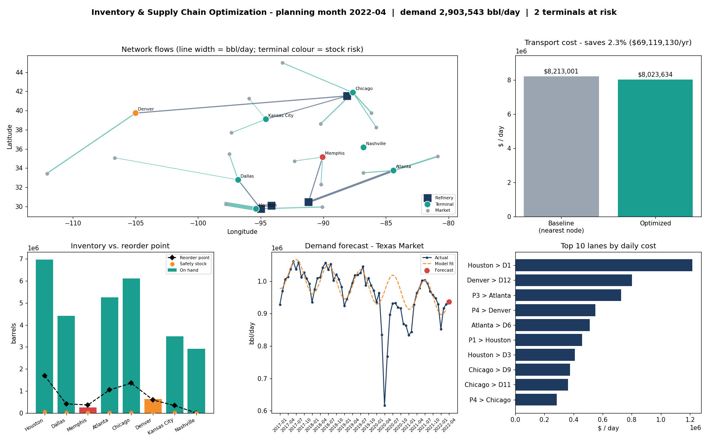
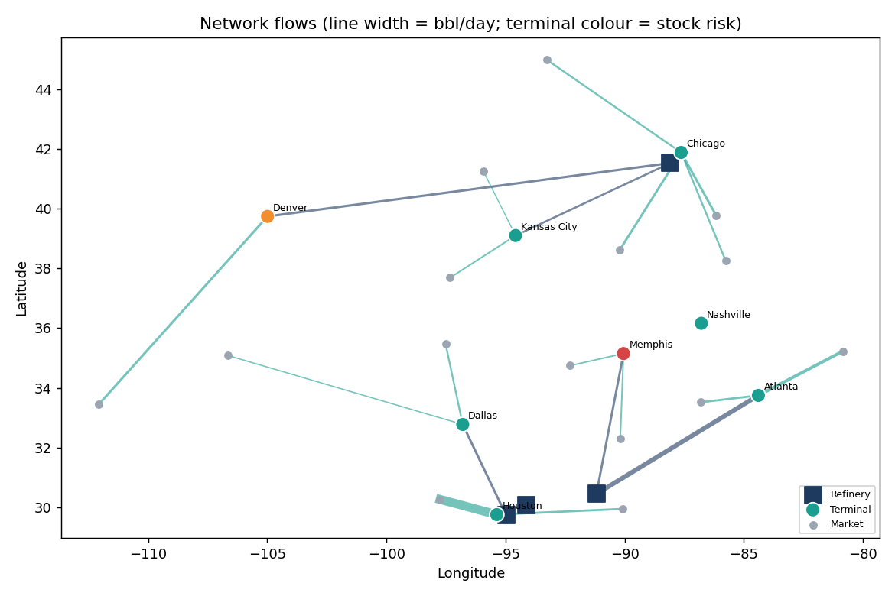
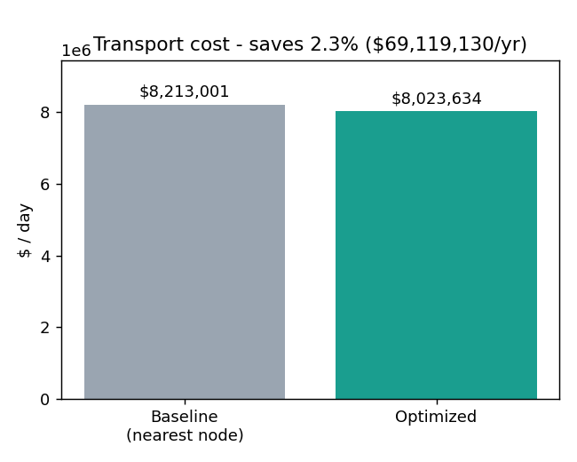
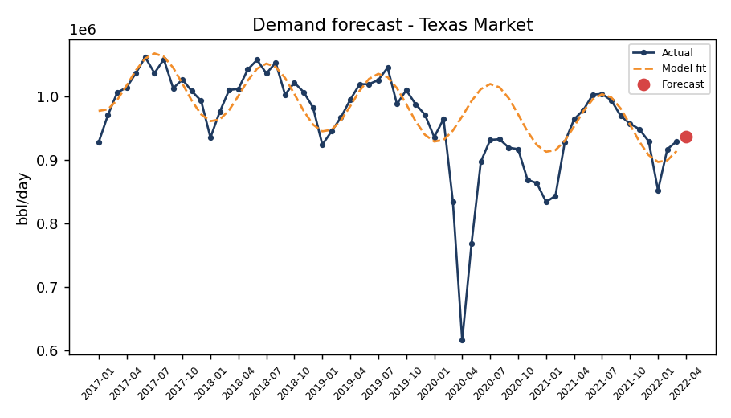
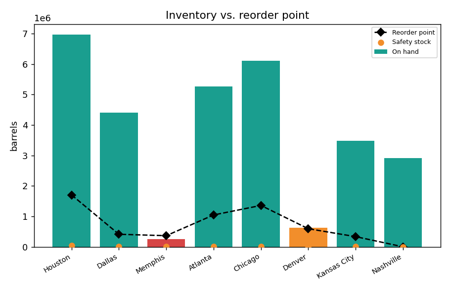
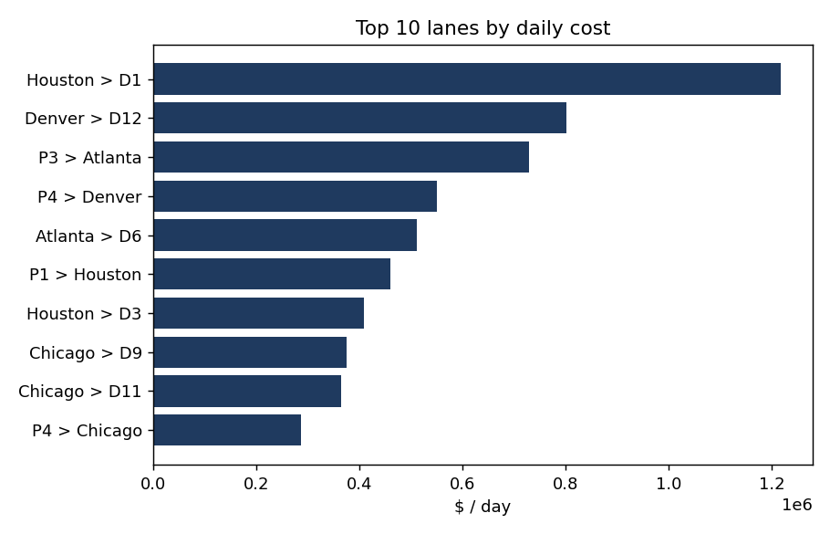

# 🛢️ Inventory & Supply Chain Optimization: Min-Cost Network Flow


End-to-end model of a US gasoline distribution network (**4 refineries → 8 terminals → 15 state markets**) built on real EIA data. It forecasts demand, finds the cheapest way to ship it, and flags terminals that are running low on stock.

> **TL;DR:** For the planning month 2022-04, the optimized network costs **$8.02M/day** against **$8.21M/day** for a nearest-node baseline, a saving of **2.3% (about $69M/year)**. The demand forecast cuts error by about 59% against a naive baseline, and 2 of 8 terminals need replenishment attention.



---

## 📑 Contents
[Pipeline](#-pipeline) · [Results](#-results) · [Charts](#-charts) · [SQL analysis](#-sql-analysis) · [Limitations](#-limitations) · [Run it](#-run-it-yourself) · [Structure](#-project-structure)

---

## 🔄 Pipeline

| Step | What happens | Where |
|---|---|---|
| 1. Data | EIA national monthly gasoline sales (2017-01 to 2022-03) and the EIA Prime Supplier Report (state shares), converted to barrels/day | `data/raw/`, `src/build_real_data.py` |
| 2. SQL | Data loaded into SQLite and analysed | `sql/schema.sql`, `sql/analysis_queries.sql` |
| 3. Forecast | scikit-learn Linear Regression per market (trend + seasonality). COVID months (2020-03 to 2020-12) excluded from fitting. Test = last 12 months | `src/forecast.py` |
| 4. Optimization | Min-cost network flow (refinery → terminal → market) solved with a Successive Shortest Paths solver written in plain Python, compared with a nearest-node baseline | `src/min_cost_flow.py`, `src/optimize_network.py` |
| 5. Inventory policy | Safety stock and reorder points per terminal (95% service level, lead times) | `src/optimize_network.py` |

---

## 📈 Results

Planning month: **2022-04**, total demand **2,903,543 bbl/day**.

### Headline numbers

| Metric | Value |
|---|---|
| Forecast MAE (average across the 15 markets) | 3,632 bbl/day vs 8,786 for naive baseline (~59% lower) |
| Transport cost, optimized | $8,023,634/day |
| Transport cost, nearest-node baseline | $8,213,001/day |
| Saving | $189,367/day, **2.3%** (about $69M/year) |
| Terminals at or below reorder point | 2 (Memphis below, Denver at risk) |
| Average terminal utilization | 26% |

### Terminal inventory status

| Terminal | Avg daily throughput | Safety stock | Reorder point | On hand | Status |
|---|---|---|---|---|---|
| Houston (T1) | 1,105,522 | 43,009 | 1,701,291 | 6,967,567 | ✅ Above ROP |
| Dallas (T2) | 186,896 | 5,599 | 410,403 | 4,408,053 | ✅ Above ROP |
| **Memphis (T3)** | 179,959 | 4,011 | 363,929 | 248,842 | 🔴 **Below ROP** |
| Atlanta (T4) | 445,810 | 12,597 | 1,044,574 | 5,261,224 | ✅ Above ROP |
| Chicago (T5) | 641,543 | 5,569 | 1,357,078 | 6,114,395 | ✅ Above ROP |
| **Denver (T6)** | 192,595 | 14,767 | 592,552 | 632,769 | 🟠 **At risk** |
| Kansas City (T7) | 151,218 | 4,397 | 332,890 | 3,483,783 | ✅ Above ROP |
| Nashville (T8) | 0 | 0 | 0 | 2,915,003 | ✅ No planned throughput |

Memphis is already under its reorder point and Denver is within a small margin of it, so those two are the replenishment priorities.

### Optimal refinery → terminal flows

| Refinery | Terminal | Flow (bbl/day) | Cost per bbl | Lane cost ($/day) |
|---|---|---|---|---|
| Baytown (P1) | Houston (T1) | 1,105,522 | 0.42 | 460,008 |
| Baytown (P1) | Dallas (T2) | 186,896 | 1.01 | 188,915 |
| Baton Rouge (P3) | Memphis (T3) | 179,959 | 1.28 | 229,898 |
| Baton Rouge (P3) | Atlanta (T4) | 445,809 | 1.63 | 728,230 |
| Joliet (P4) | Chicago (T5) | 641,543 | 0.44 | 285,166 |
| Joliet (P4) | Denver (T6) | 192,595 | 2.85 | 549,339 |
| Joliet (P4) | Kansas City (T7) | 151,218 | 1.42 | 214,231 |

Beaumont (P2) and Nashville (T8) carry no flow in the optimal plan.

---

## 🖼️ Charts

### Optimal network flows


Line width shows barrels/day. Terminal colour shows stock risk: 🟢 healthy, 🟠 Denver at risk, 🔴 Memphis below reorder point.

### Cost: optimized vs nearest-node baseline


### Demand forecast


The COVID dip in 2020 is plotted but excluded from model fitting, so it does not distort the trend or seasonality.

### Inventory vs reorder point


### Most expensive lanes


The most expensive lanes (Houston → Texas market, Denver → Arizona market) are the first cost-reduction targets.

---

## 🗃️ SQL analysis

`sql/analysis_queries.sql` runs against `sql/scm_network.db` (SQLite) and covers:

1. Network capacity check: total plant capacity vs total terminal throughput
2. Month-over-month demand trend by region (last 6 months)
3. Demand statistics per region (mean, stdev, coefficient of variation) feeding the safety-stock calculation
4. Cheapest terminal-to-region lane per market
5. Total network cost breakdown after optimization
6. Terminal utilization after optimization
7. Terminals below reorder point (replenishment risk list)
8. Top 10 most expensive active lanes
9. Real-data check: each market's share of US gasoline vs its latest demand

---

## ⚠️ Limitations

- EIA gives only 2–3 months of state data, so state history uses the national seasonal shape × each state's share. The forecasts therefore share the same seasonal pattern across states.
- These inputs are **assumptions, not EIA data**: node cities and coordinates, plant and terminal capacities, production and holding costs, lead times, lane rates, and current inventory.
- The 2.3% saving is relative to a simple nearest-node baseline and depends on the assumed lane rates, so treat it as indicative.
- The forecast is a basic linear trend plus seasonality model, evaluated on one 12-month hold-out.

---

## ▶️ Run it yourself

```bash
pip install -r requirements.txt
cd src
python build_real_data.py                  # raw EIA files -> data/*.csv
cd ../sql && python build_db.py && cd ../src
python optimize_network.py                 # forecast -> optimize -> inventory policy -> results/
python make_charts.py                      # charts/
```

---

## 🗂️ Project structure

```
data/                   # input CSVs (raw EIA files in data/raw/)
sql/                    # schema, analysis queries, SQLite database, build script
src/
  build_real_data.py    # raw EIA files -> data/*.csv
  forecast.py           # linear regression demand forecast
  min_cost_flow.py      # Successive Shortest Paths solver
  optimize_network.py   # forecast -> optimize -> inventory policy
  make_charts.py        # charts/
results/                # KPIs, flows, forecasts, inventory recommendations
charts/                 # PNG charts used in this README
```

**Data:** [US EIA](https://www.eia.gov) national monthly gasoline sales and Prime Supplier Report.
